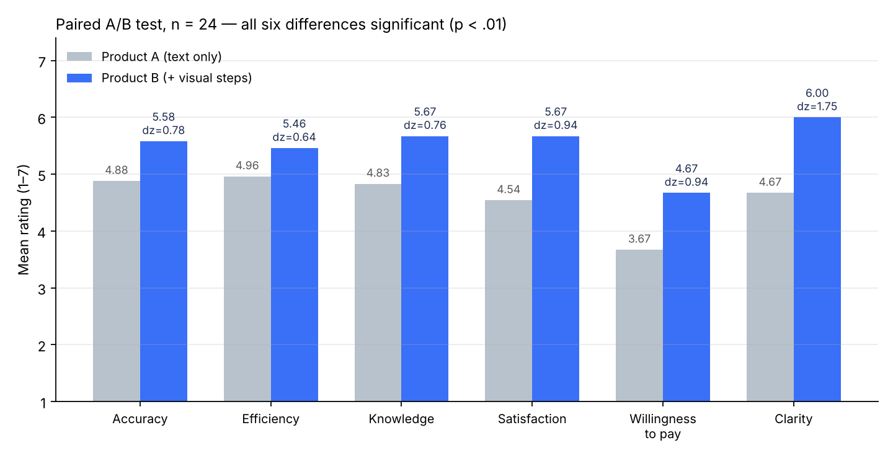

# OmniTutor Kids：一次只改一个变量的 A/B 实验

> AI 苏格拉底式学习助手（面向澳洲 4–6 年级学生）。验证"在讲解中加入可视化图解"能否提升用户体验。
> UNSW 产品分析课程小组项目，我担任产品负责人。

**在线体验：** `https://leij678-warmglass.github.io/omnitutor-ab-test/`
（开启 GitHub Pages 后可用；首页可以分别打开 Product A 和 Product B）

## 1. 问题从哪来

第一版 MVP 做了 31 人测试，两个问题最突出：

| 问题 | 占比 |
|---|---|
| 找不到需要的功能 | 38.7%（12/31） |
| 答案讲解不清楚 | 35.5%（11/31） |

前期我们还抓取了 App Store 和 Google Play 上竞品的用户评论，用意图识别和情感分析找出未被满足的需求，再用重要性-满意度矩阵排出优先级。

## 2. 假设

**X = 在关键讲解步骤加入可视化图解**（例如把 3 × 5 画成"3 袋饼干"，用颜色框标出先乘后加）。

- Product A：第一版 MVP，纯文字对话
- Product B：和 A 完全相同，只多了 X

理论依据是 Mayer 的多媒体学习原则：文字加图片比只有文字更容易理解。所以我们预测**讲解清晰度**会提升最多。

## 3. 实验设计

- **配对设计**：每位参与者先完整使用 A 并打分，再使用 B 并用同样的题目打分
- **6 个指标**（1–7 分）：准确性、效率、知识帮助、满意度、付费意愿、讲解清晰度
- **样本**：24 份完整配对问卷
- **检验方法**：单尾配对 t 检验，用 Wilcoxon 符号秩检验做稳健性检查；开放评论做人工情感编码

## 4. 结果

| 指标 | A | B | 差值 | t | Cohen's dz |
|---|---|---|---|---|---|
| 准确性 | 4.88 | 5.58 | +0.71 | 3.82 | 0.78 |
| 效率 | 4.96 | 5.46 | +0.50 | 3.14 | 0.64 |
| 知识帮助 | 4.83 | 5.67 | +0.83 | 3.74 | 0.76 |
| 满意度 | 4.54 | 5.67 | +1.13 | 4.63 | 0.94 |
| 付费意愿 | 3.67 | 4.67 | +1.00 | 4.61 | 0.94 |
| **讲解清晰度** | 4.67 | **6.00** | **+1.33** | 8.58 | **1.75** |

- 6 个假设全部成立（p < .01），提升最大的正是理论预测的清晰度
- 愿意继续使用 B 的有 16 人，A 只有 1 人
- 开放评论正面占比从 38% 升到 96%

## 5. 产品决策

1. 把图解层放进第二版 MVP 路线图，优先覆盖错题日志里出错最多的知识点
2. 掌握后允许跳过图解（来自用户建议，也符合"一致性原则"）
3. 把清晰度提升作为对家长的卖点，因为家长是付费决策者

## 6. 局限

- 固定先 A 后 B 的顺序可能带来新鲜感效应
- 样本 24 人，低于 30 人目标；83% 为大学生，后续需用真实 4–6 年级学生复测

## 文件说明

| 文件 | 内容 |
|---|---|
| `index.html` | 首页：结果摘要和 A/B 入口 |
| `a.html` / `b.html` | 两个版本的脚本化演示（同一套对话，B 多了图解） |
| `app.js` | 对话脚本和图解 |
| `assets/results.png` | 结果图 |

> 说明：本仓库的演示是测试版本的轻量网页复刻，用于作品展示；原型最初在 IBM Watson Assistant 上搭建。
