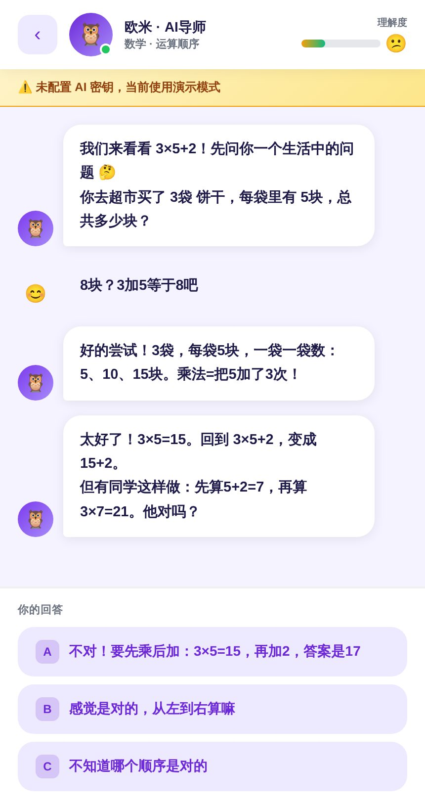
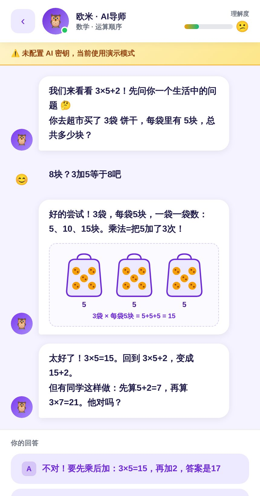
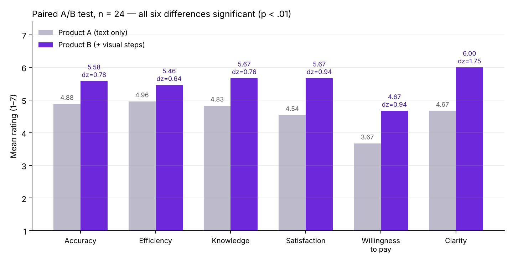

# OmniTutor Kids：同一个 AI 学伴，两个版本

> 面向 4–6 年级学生的 AI 苏格拉底式学习助手：不直接给答案，一步步提问引导孩子自己想出来。
> 我们做了 Product A 和 Product B 两个版本，只差一个功能，用来验证"讲解里加一张图"能否让孩子更容易听懂。
> UNSW 产品分析课程 4 人小组项目。我负责用户需求分析（竞品评论分类、共情地图、用户旅程）、产品流程图、A/B 问卷设计和结果可视化。

## 在线体验

| | 链接 | 说明 |
|---|---|---|
| 首页 | https://leij678-warmglass.github.io/omnitutor-ab-test/ | 两版对比、产品流程、测试结果 |
| Product A | https://loom-swing-43299802.figma.site/ | 纯文字苏格拉底式引导 |
| Product B | https://omnitutorpro.netlify.app/ | 同样的流程 + 分步可视化图解 |

两个版本的代码也放在本仓库里（`product-a/`、`product-b/`），首页的"GitHub 镜像版"可以直接打开。

**体验路径：** 跳过登录（访客模式）→ 数学 → 例题 3 × 5 + 2 → 开始学习。故意选错一次，就能看到 B 版的图解。也可以用学生、教师、家长三种演示账号进入。

| Product A | Product B |
|---|---|
|  |  |

## 两版唯一的区别

Product B 在三个讲解节点（举例鼓励、补充教学、答错引导）以及对话小结和练习反馈里，附上一张概念图解：

- 数学：3 袋 × 5 块饼干（乘法 = 重复加法）、颜色框标出"先乘后加"
- 科学：热量从手传到冰块、冰 → 水 → 水蒸气
- 历史：长城阻挡骑兵、保护农田
- 编程：for 循环重复 5 次

其他所有模块完全相同。

## 产品功能

- **学生端**：选科目（数学、科学、历史、编程）提问或拍照上传题目；AI 苏格拉底式引导，根据回答质量给出表扬、鼓励举例或补充教学；对话结束有 2–3 条小结和 2 道巩固题；理解度进度条
- **家长端**：每周学习报告，包括各科表现、学习时长、解题数、待提升知识点；支持管理多个孩子
- **教师端**：班级总览、学生个人进度、题库管理（按科目和难度筛选、添加题目）、布置作业
- 中文、英文、韩文三种界面语言
- 默认是脚本演示模式；在右上角填入自己的 Gemini API 密钥可切换为真实 AI 对话（密钥只保存在本地浏览器）

## 产品流程

两版共用同一套用户旅程：登录选角色 → 学生仪表盘 → 提问或练习 → 答题反馈 → 小结 → 巩固练习 → 进度同步到家长和教师端。

- [Product A 流程图](flow/flow-product-a.png)
- [Product B 流程图](flow/flow-product-b.png)（紫色虚线标出新增图解的位置）
- [两版流程图 PDF](flow/journey-flow-A-B.pdf)

## 附：A/B 测试结果



24 人配对测试：每人先用 A 再用 B，对 6 项指标打分（1–7 分），用单尾配对 t 检验和 Wilcoxon 符号秩检验分析。

| 指标 | A | B | 差值 | t | p（单尾） | Cohen's dz |
|---|---|---|---|---|---|---|
| 准确性 | 4.88 | 5.58 | +0.71 | 3.82 | <.001 | 0.78 |
| 效率 | 4.96 | 5.46 | +0.50 | 3.14 | .002 | 0.64 |
| 知识帮助 | 4.83 | 5.67 | +0.83 | 3.75 | <.001 | 0.76 |
| 满意度 | 4.54 | 5.67 | +1.12 | 4.63 | <.001 | 0.94 |
| 付费意愿 | 3.67 | 4.67 | +1.00 | 4.61 | <.001 | 0.94 |
| **讲解清晰度** | 4.67 | **6.00** | **+1.33** | 8.58 | <.001 | **1.75** |

- 6 个假设全部成立，提升最大的是理论预测的讲解清晰度
- 愿意继续使用 B 的有 16 人，A 只有 1 人
- 局限：固定先 A 后 B 的顺序可能有新鲜感效应；样本 24 人，以大学生为主

分析代码：[`analysis/ab_test_analysis.ipynb`](analysis/ab_test_analysis.ipynb)（VADER 情感分析 + 六个假设检验），结果：[`analysis/hypothesis_results.csv`](analysis/hypothesis_results.csv)。原始问卷数据涉及受访者隐私，未公开。

## 文件结构

```
index.html              首页：两版对比、产品流程、测试结果
product-a/index.html    Product A（单文件 React 应用）
product-b/index.html    Product B（单文件 React 应用）
flow/                   两版用户旅程流程图（PNG + PDF）
analysis/               分析 Notebook、假设检验结果、结果图
images/                 截图
```

> Product A 与 B 使用同一份代码构建，A 版关闭了可视化图解功能。
